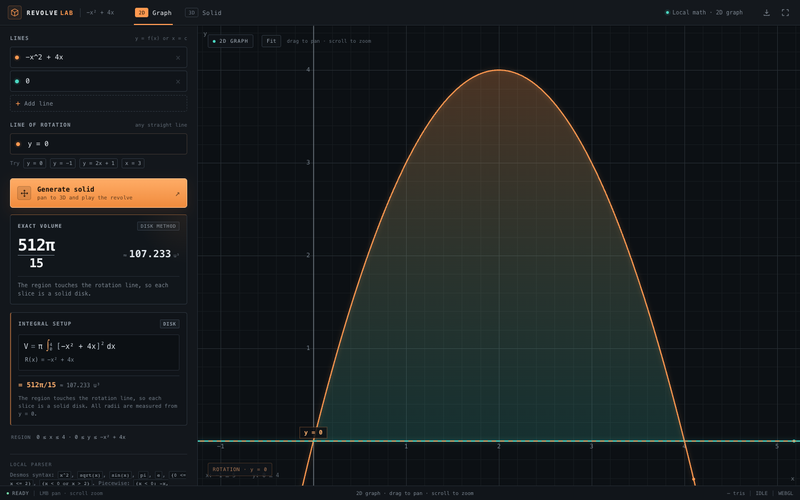

# Revolve Lab

A local, dark, Desmos-style studio for solids of revolution. Enter any number of
function lines and a rotation line, inspect the enclosed region on a 2D graph,
then generate a 3D solid with an exact volume and a styled integral setup.

Everything runs in the browser. There is no AI parser, no model service, no API
proxy, and no network math dependency.



## Getting started

```bash
git clone https://github.com/contraliz/revolvelab.git
cd revolvelab
npm install
npm run dev
```

Open the local URL printed by Vite. Node.js 20+ is recommended. The UI bundles
MesloLGS Nerd Font in `public/fonts`, so no font installation is needed.

```bash
npm run build
npm run preview
```

## What it does

- Starts on a full-size 2D graph with a compact expression sidebar.
- Accepts any number of `y = f(x)` lines, each with its own color.
- Accepts vertical boundary lines such as `x = 4`; a bare expression is treated
  as `y = ...`.
- Can be emptied completely. With zero lines, the editor shows only **Add line**.
- With a single line, the x-axis and y-axis close the region in the first
  quadrant, so `y = 4 - x^2` immediately gives the quarter-cap region.
- Finds the enclosed region or regions where pairs of curves meet or are cut by
  a domain restriction or a vertical boundary.
- Supports horizontal, vertical, and slanted rotation lines:
  `y = 0`, `y = -1`, `y = 2x + 1`, `x = 3`.
- Shows the exact volume when the result is a rational multiple of π, and a
  high-accuracy numerical volume otherwise.
- Displays the washer/disk or perpendicular-slice integral setup with styled
  limits, brackets, exponents, radii, and the final result.
- Generates the solid with a 2D → 3D camera transition and plays the revolve
  from profile to full solid.
- Renders on demand. There is no OrbitControls damping or inertial glide, and
  the animation loop stops when the scene is idle.

## Desmos-compatible input

Enter either a full equation or just the right-hand side:

```text
y = -x^2 + 4x
-x^2 + 4x
x = 4
```

A leading `y =` or `f(x) =` is optional. A line beginning with `x =` is a
vertical boundary that can close the left or right side of the region.

If only one line is present, the editor assumes the remaining boundaries are the
coordinate axes: the x-axis becomes the horizontal boundary and the y-axis
clips the region to the first quadrant. `y = 4 - x^2` then encloses
`0 <= x <= 2, 0 <= y <= 4 - x^2`.

### Expressions

```text
-x^2 + 4x
sqrt(x)
sin(pi x)
e^x
|x - 1|
2x(x + 1)
log(100)
ln(e)
```

Supported syntax includes:

- arithmetic: `+ - * / ^`, unary minus, implicit multiplication (`2x`, `x(x+1)`,
  `2 sin(x)`)
- constants: `pi`, `tau`, `e`, `infinity`
- functions: `sqrt`, `cbrt`, `abs`, `sin`, `cos`, `tan`, `cot`, `sec`, `csc`,
  inverses such as `asin`/`arcsin`, hyperbolics, `ln`, `log` (base 10),
  `log10`, `exp`, `floor`, `ceil`, `round`, `sign`, `min`, `max`, `mod`,
  `nthroot`, `atan2`, `pow`
- comparisons: `<`, `<=`, `>`, `>=`, `=`, `!=`
- logical operators: `and`, `or`, `not`
- chained comparisons: `0 <= x <= 2`

### Domain restrictions

Attach curly braces to a function, exactly as in Desmos:

```text
-x^2 + 4x {0 <= x <= 4}
x^2 {0 <= x <= 2}
sqrt(x - 3) + 2 {3 <= x <= 12}
```

Multiple restrictions intersect:

```text
x^2 {x > 0}{x < 2}
```

Use `and` / `or` for more complex domains:

```text
x^2 {x > 0 and x < 2}
x^2 {x < 0 or x > 2}
```

A restriction may involve `y` as well; it is evaluated against the function
value.

### Piecewise functions

```text
{x < 0: -x, x >= 0: x^2}
{x < -1: -2, -1 <= x <= 1: x, 2}
```

Branches are evaluated left to right. A branch without a condition is the
fallback value.

## How the math works

For horizontal rotation lines `y = k`, the region is sliced perpendicular to the
x-axis. Each slice contributes an annulus with outer radius `R(x)` and inner
radius `r(x)`:

```text
V = π ∫ [R(x)² − r(x)²] dx
```

If the rotation line touches the region, the inner radius is zero and the slice
is a disk.

For vertical or slanted lines, the same idea is applied in coordinates measured
along the rotation line. The region is sampled as a polygon, sliced
perpendicular to the axis, and each slice is rotated into a disk or annulus. This
also works when the rotation line passes through the region.

Exact volumes are detected when `V / π` is a rational number with a small
denominator. For example, the default region gives `512π/15`. Polynomial
boundaries, `sqrt` boundaries about `y = 0`, and restricted polynomial regions
can all produce exact results. Other shapes use adaptive Simpson integration
(horizontal axes) or high-resolution perpendicular slicing and are labeled
**numerical volume**.

The region finder looks for intervals where a pair of curves is closed at both
ends — either because the curves meet, a domain restriction ends, or a vertical
boundary line crosses. Nested regions are removed so overlapping pairs are not
double-counted.

## 3D view

- One xz grid plane at `y = 0`, centered on the true origin.
- `x`, `y`, and `z` axes pass through `(0, 0, 0)`.
- The orange dashed line is the actual rotation line.
- The source region is shown as a cut face at profile angle 0°.
- Shading modes: solid, X-ray, and a sparse meridian/ring wireframe.
- The wireframe is a contour network, not the full triangle mesh, so it stays
  legible on high-resolution solids.
- Timeline: profile, cutaway, full solid, and scrubbable angle.

## Controls

- **2D graph:** drag to pan, scroll to zoom, double-click or **Fit** to reframe.
- **3D:** left drag to orbit, right drag to pan, scroll to zoom.
- `Space` play/pause, `F` frame, `G` grid, `W` wireframe, `X` X-ray,
  `R` reset view, `1` graph, `2` solid, `Esc` close the mobile panel.
- On narrow screens, the expression panel opens from the top-left menu button.

## Performance notes

- WebGL renders only when the camera, solid, animation, or graph changes.
- `OrbitControls.enableDamping` is off, so a released drag stops immediately.
- Pixel ratio is capped at 2.
- The solid builder omits the inner surface when the shape is a disk, and refines
  each profile to its true zero-radius end so pointed tips close cleanly instead
  of being sliced into a small cap.
- The continuous animation loop stops as soon as playback and camera tweening
  finish.

## Project layout

```text
src/expression.js   safe Desmos-style parser/evaluator and integration
src/region.js       region finding, rotation axes, volume, formula metadata
src/solid.js        revolved mesh builder for horizontal and slanted axes
src/plot2d.js       interactive 2D canvas graph
src/main.js         UI, Three.js scene, transitions, render-on-demand loop
src/style.css       dark expression-editor layout
index.html          application shell
```

## Credits

The interface uses **MesloLGS Nerd Font** for every label, equation, and control.
The font is bundled in `public/fonts` under the Apache License 2.0, with Nerd
Fonts patches under the MIT and SIL OFL 1.1 licenses. See
`public/fonts/MesloLGSNerdFont-LICENSE.txt`.

The parser and geometry pipeline are original implementations built with
Three.js. This project is not affiliated with Desmos or Blender.
