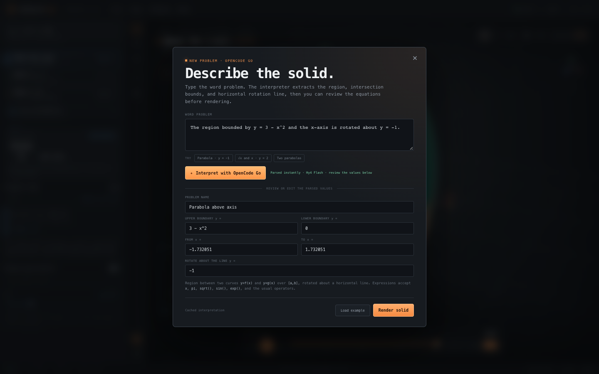

# Revolve Lab

## Installation

```bash
git clone https://github.com/contraliz/revolvelab.git
cd revolvelab
npm install
npm run dev
```

Open the local URL printed by Vite.

**Requirements**

- Node.js 20+
- No font install is needed: the UI bundles MesloLGS Nerd Font in `public/fonts`.
- For AI question parsing: a running local OpenCode service with the
  `opencode-go` provider authenticated. Manual equation entry works without it.

Production build:

```bash
npm run build
npm run preview
```

`npm run preview` also runs the local AI proxy.


A Blender-inspired, interactive Three.js study of solids of revolution. It ships
with the parabolic region

\[
y=-x^2+4x,\qquad 0\le x\le 4,
\]

and adds an AI-assisted problem builder: type a word problem, review the parsed
region, and render a new solid.

## Custom problems



Click **Ask a new question** in the properties panel, or press `N`.

The first version supports regions between two functions \(y=f(x)\) and
\(y=g(x)\) on an interval \([a,b]\), rotated about a horizontal line
\(y=k\). You can either:

1. Type a word problem and click **Interpret with OpenCode Go**.
2. Fill in the boundary equations, interval, and rotation line manually.

The parsed values are always shown for review before rendering. Expressions
support `x`, `pi`, `e`, `sqrt()`, `sin()`, `cos()`, `exp()`, `log()`, powers,
and the usual arithmetic operators.

Examples:

- `The region bounded by y = sqrt(x) and y = x is rotated about y = 2.`
- `The region bounded by y = x^2 and y = 2 - x^2 is rotated about the x-axis.`
- `The region bounded by y = 4 - x^2 and the x-axis is rotated about y = -1.`

Vertical and slanted rotation lines are detected and rejected in this version.
Custom volumes are evaluated numerically with adaptive Simpson integration and
shown as a numerical volume rather than a symbolic fraction.

## How the AI parsing works

The browser sends the question to `/api/interpret`, a small Vite middleware in
`vite.config.js`. That server-side handler reads the local OpenCode service
registration, calls OpenCode Go through the local API, and validates the model
output before returning it.

The provider key is never sent to the browser.

The default interpreter model is **DeepSeek V4.1 Flash** with low reasoning.
If that model is temporarily unavailable, the request falls back to Hy4 Flash.

Relevant environment variables:

```bash
OPENCODE_PARSE_PROVIDER=opencode-go
OPENCODE_PARSE_MODEL=deepseek-v4.1-flash
OPENCODE_PARSE_VARIANT=low
OPENCODE_PARSE_FALLBACK_MODEL=hy4-flash-free
OPENCODE_PARSE_FALLBACK_VARIANT=none
```

Optional service file overrides:

```bash
OPENCODE_STATE_FILE=/path/to/state/opencode/service.json
OPENCODE_CONFIG_FILE=/path/to/config/opencode/service.json
```

The parser requires a running local OpenCode service with an authenticated
`opencode-go` provider. If it is unavailable, the manual fields still work.
Static deployments need their own equivalent backend endpoint; the bundled Vite
middleware only runs during `dev` and `preview`.

## The built-in volumes

### A. Rotation about the \(x\)-axis

\[
V_A=\pi\int_0^4(-x^2+4x)^2\,dx
=\frac{512\pi}{15}
\approx 107.233\ \text{u}^3.
\]

### B. Rotation about \(y=-1\)

\[
V_B=\pi\int_0^4\left[(-x^2+4x+1)^2-1\right]dx
=\frac{832\pi}{15}
\approx 174.254\ \text{u}^3.
\]

### C. Rotation about \(y=5\)

\[
V_C=\pi\int_0^4\left[25-\left(5-(-x^2+4x)\right)^2\right]dx
=\frac{1088\pi}{15}
\approx 227.870\ \text{u}^3.
\]

## Interaction

- **Orbit / pan / zoom** with left drag, right drag, and the scroll wheel.
- **Timeline** sweeps the source region from \(0^\circ\) to \(360^\circ\).
- **Cutaway** stops at \(270^\circ\) so the washer-shaped cross-sections are visible.
- **Shading** switches between material preview, X-ray, and wireframe.
- **Washers** displays a midpoint Riemann approximation with adjustable slice count.
- **Profile / Full solid** snaps back to the source region or the completed solid.
- **Viewport presets** repeat the `Profile` and `360°` actions in the top-right viewport toolbar.
- **Generating region graph** shows a color-coded 2D graph of \(f(x)\), \(g(x)\), and the rotation line.
- **3D coordinate frame** draws \(x\), \(y\), and \(z\) axes with tick marks, plus floor and vertical grid planes alongside the orange rotation axis.
- Keyboard: `1` `2` `3` switch axes, `Space` play/pause, `4` cutaway, `F` frame, `G` grid, `W` wireframe, `X` X-ray, `N` new problem.

## Geometry notes

The renderer builds surfaces of revolution from radial inner/outer profiles over
an arbitrary \(x\)-interval. It adds annular end caps when a problem does not
pinch to zero thickness at the domain boundary. This is what allows the original
parabola and new custom shapes such as cylinders or hemispheres to share the
same pipeline.

The interface is an original Blender-inspired layout built with Three.js. It is
not affiliated with Blender.

## Credits

The interface uses **MesloLGS Nerd Font** for every label, equation, and control.
The font is bundled in `public/fonts` under the Apache License 2.0, with Nerd
Fonts patches under the MIT and SIL OFL 1.1 licenses. See
`public/fonts/MesloLGSNerdFont-LICENSE.txt`.
